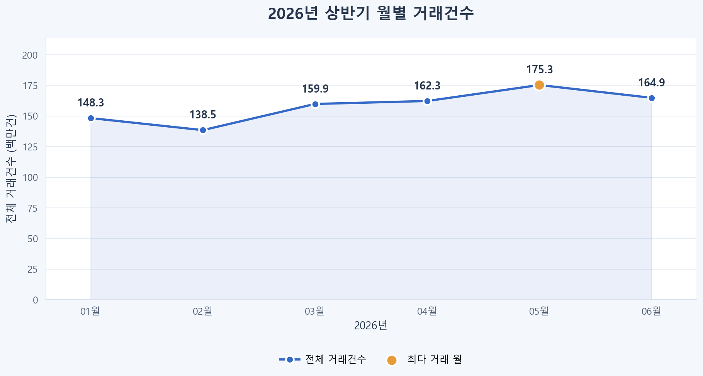
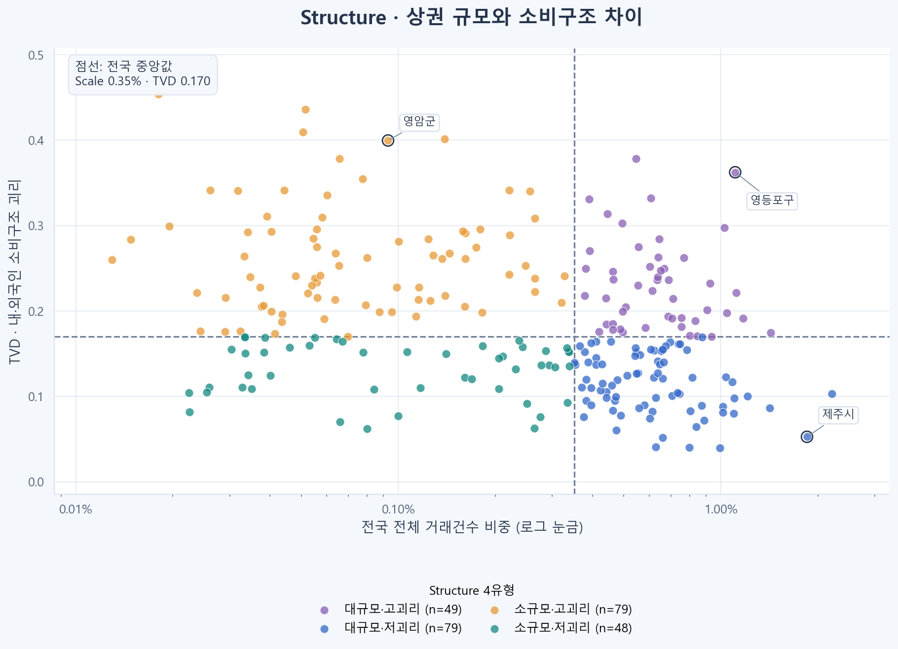
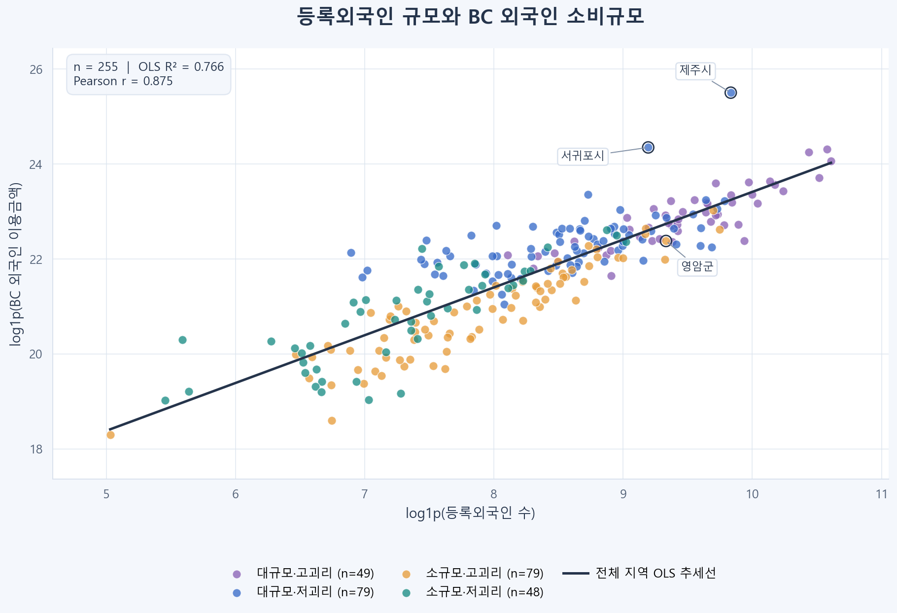
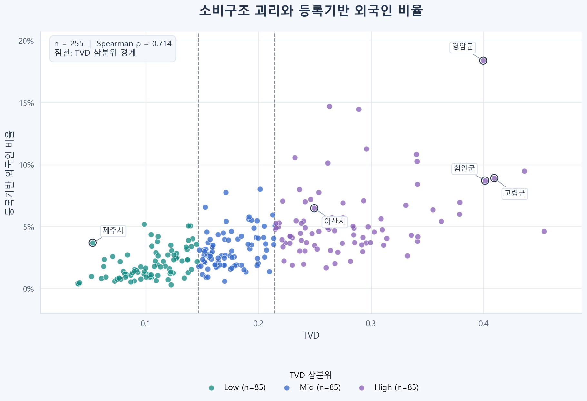
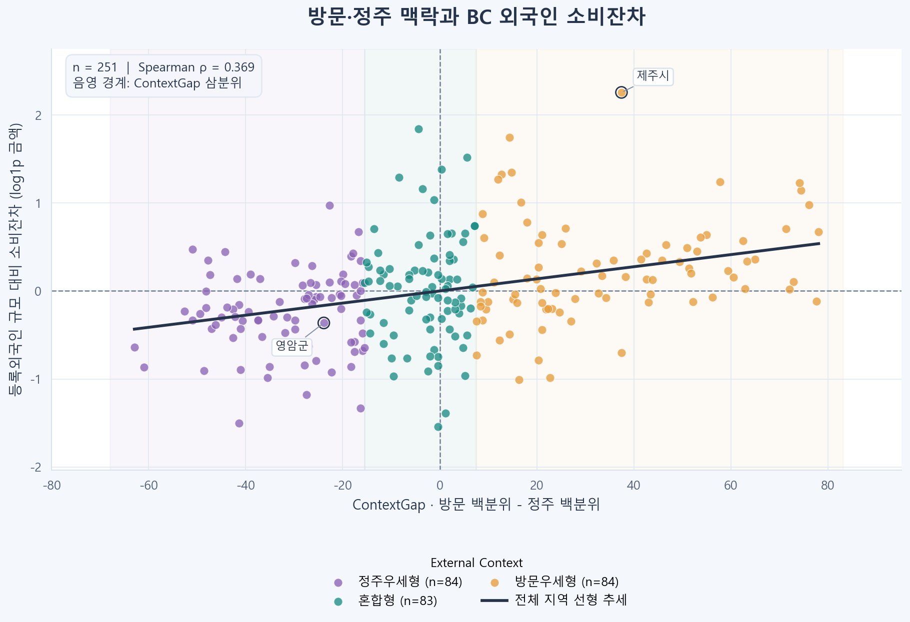

# BC카드 외국인 소비구조 기반 상권 진단

255개 지역의 소비구조·거래 변화·정주/방문 맥락을 연결하는 분석 및 다국어 Action 대시보드입니다.

[English](README.md) | [한국어](README.ko.md) | [简体中文](README.zh-CN.md)

[배포된 대시보드 바로 보기](https://bccarddataanalysis.vercel.app/) — 별도 설치 없이 웹에서 프로젝트를 확인하실 수 있습니다.

## 프로젝트 개요

- 문제정의: 외국인 소비액이나 비중만으로 지역을 순위화하면, 소비구조와 수요 맥락이 다른 상권을 같은 유형으로 취급할 수 있습니다. 지역의 규모·소비구조·최근 변화·외부 맥락을 나누어 진단할 필요가 있습니다.
- 해결방법: 2026년 1~6월 BC카드 집계 데이터에서 내·외국인의 업종별 소비금액 구성 차이를 TVD로 정의하고, 지역별 전국 거래건수 비중과 함께 상권을 4유형으로 분류했습니다. 거래건수(CNT)와 건당 평균 결제금액(ATV)의 최근 변화에서 같은 기간 전국 변화를 뺀 값을 Momentum으로 정의해 지역의 상대적 흐름을 살폈습니다. 비교 기간을 3개월·2개월로 바꿔도 변화 방향과 크기가 안정적인지를 Confidence로 평가했습니다. 등록외국인·주민등록인구·방문자 데이터로 정주와 방문 수요의 상대적 우세를 구분하고, 진단을 미리 정한 실행 규칙·근거 자료에 연결했습니다. 선택 기능으로 외부 언어모델인 Qwen을 API로 호출하여, 진단과 근거를 바탕으로 실행안 설명을 생성하도록 구성했습니다.
- 결과물 활용: 대시보드에서 255개 지역을 검색·필터·비교하고 업종 구성, 거래 변화, 정주/방문 맥락, 보조 공급 지표를 탐색할 수 있습니다. 카드사·소상공인·지자체별 규칙 기반 Action Card와 근거를 확인하고, 서버 설정 후 Qwen API를 호출하여 실행안 설명을 생성하는 기능을 이용하실 수 있습니다.

팀 공모전 프로젝트의 분석과 웹 프로토타입입니다. 정량 분석의 기준은 [BC_analysis.ipynb](BC_analysis.ipynb)이며, 웹 구현의 추가 규칙·보조 자료는 [구현 기록](demo/IMPLEMENTATION.md)에서 구분합니다.

## 주요 결과 및 대표 이미지

| 결과 | 값과 해석 |
|---|---|
| 분석 범위 | 242,574개 집계 행 · 255개 지역 · 11개 업종 · 2026년 1~6월 |
| 4유형의 기간 안정성 | 1~3월 대 4~6월 일치율 92.2%, Cohen’s κ=0.893 |
| Momentum 기간창 상관 | 3개월 대 2개월: CNT Pearson r=0.983, ATV r=0.980 |
| TVD 외부 비교 | 등록기반 외국인 비율과 Spearman ρ=0.714, n=255 |
| External Context | 181일 완전관측 251개 지역; 4개 지역은 분류 보류 |
| 규칙 출력 검증 | 3개 언어 × 255개 지역 × 3개 이해관계자 = 2,295개 출력 검사 |

통계 수치는 노트북에 저장된 출력이며 이번 문서 작성에서 비공개 원자료로 재추정하지 않았습니다. 규칙 출력 검증은 현재 코드에서 재실행했으며, 추천의 실제 효과나 LLM 응답 품질을 측정한 결과는 아닙니다.

### 1. 월별 거래 변화



법인을 포함한 전체 거래건수의 월별 변화를 보여줍니다. 원자료는 개별 결제 기록이 아니라 집계 패널입니다.

### 2. Scale × TVD의 4유형



전국 거래건수 비중과 내·외국인 소비구조 차이를 분리합니다. 같은 외국인 소비 핵심지역이라도 제주시와 영암군의 구조는 다릅니다.

### 3. 외국인 소비규모의 외부 비교



등록외국인 수와 외국인 카드소비액의 log1p 관계: Pearson r=0.875, OLS R²=0.766, n=255. 인과 또는 예측 성능으로 해석하지 않습니다.

### 4. TVD와 등록기반 외국인 비율



Spearman ρ=0.714. TVD 삼분위별 등록기반 외국인 비율 중앙값은 1.58% → 2.83% → 4.81%입니다.

### 5. 방문·정주 맥락과 소비잔차



ContextGap과 등록외국인 규모로 설명되지 않는 log1p 소비액 잔차의 Spearman ρ=0.369, n=251. 방문 목적이나 인과관계를 식별하지 않습니다.

이미지 5개는 기존 분석 수치를 유지하면서 시각화 스타일을 개선해 새로 렌더링했습니다. 이 README에는 한국어 그래프를 사용했습니다.

## 개인 기여도

팀 프로젝트에서 담당한 작업은 다음과 같습니다.

- 문제정의
- 데이터 전처리
- 외부 데이터 수집 및 결합
- 데이터 시각화 및 분석
- MVP 웹페이지 다국어 기능 추가: 한국어·영어·중국어 간체 지원

## 데이터 및 전처리

| 데이터 | 범위와 역할 |
|---|---|
| BC카드 공모전 데이터 | 2026년 1~6월, 242,574행·9열. 월 × 시군구 × 성별/외국인 × 연령 × 업종 집계 |
| 법무부 등록외국인·행안부 주민등록인구 | 2026년 6월 지역별 지표를 255개 지역에 결합 |
| 한국관광공사 방문자 데이터 | 2026-01-01~2026-06-30, 노트북 기록상 145,152행; Context 엄격표본 n=251 |
| 소상공인시장진흥공단 상가정보 | 2026-06-30 원본 2,772,484개 점포를 재집계한 보조 공급 자료; 37개 소분류를 8개 분석 그룹에 대응 |
| 보조 스냅샷 | 관광·국적·군집·정책 참고 자료와 합성 폐업률. 핵심 분석 및 실측 지표와 분리 |

지역명·업종명의 공백을 정리하고 `SIDO_NM + CCG_NM`으로 지역 키를 구성합니다. `GENDER_CD=1,2`는 내국인 개인, `3`은 외국인, `x`는 법인으로 처리합니다. TVD에서는 법인을 제외하고, Scale·Momentum에는 포함합니다. 노트북의 기초 품질 검사에서는 결측 셀이 0개였습니다.

외국인 방문 비중의 분모는 `외지인 + 외국인`이며 현지인을 포함하지 않습니다. 등록기반 외국인 비율은 `등록외국인 / (주민등록인구 + 등록외국인)`입니다. 화성시 동탄·만세·병점·효행구는 150일만 관측되어 Context와 Context 기반 추천을 보류합니다.

## 방법론 및 설계 이유

| 계층 | 정의와 역할 |
|---|---|
| Structure | Scale=전국 전체 CNT 중 지역 비중. TVD=내·외국인 11개 업종 AMT 구성의 차이. 각 중앙값으로 4유형 분류 |
| Momentum | `100 × [ln(지역 후기/전기) − ln(전국 후기/전기)]`를 CNT·ATV에 각각 적용. 단위는 log %p |
| Confidence | 3M·2M 부호 일치와 `min(abs(M3), abs(M2)) > 1.4826 × MAD(M3−M2)`를 축별 검사. 두 축 Stable=High, 하나=Medium, 없음=Low |
| External Context | `방문비중 백분위 − 등록외국인 비율 백분위`. 251개 완전관측 지역 내 평균순위와 삼분위로 정주우세·혼합·방문우세 분류 |
| Action | 4개 Structure × 3개 Context × 3개 이해관계자의 36개 기본 셀, 규칙 추적과 Evidence ID를 사용. Context 보류 지역은 관찰용 별도 처리 |
| Qwen API 기반 설명 생성 | 서버에서 지역 ID·언어에 맞는 진단과 근거를 구성한 뒤, Qwen 언어모델을 API로 호출하여 이해관계자별 실행안 설명을 생성합니다. 수치 계산·유형 판정은 분석 로직에서 수행하며, 모델은 제공된 실행안 후보와 근거에 한해 설명하도록 제한합니다. |

$$TVD_r=\frac{1}{2}\sum_{k=1}^{11}|p_{D,rk}-p_{F,rk}|$$

중앙값 기준은 Scale=0.003508129, TVD=0.169768457입니다. 규모와 구성 차이를 분리하고, 단기 변화는 별도 지표로 다룹니다. 3M은 1~3월 대 4~6월, 2M은 1~2월 대 5~6월이며 노트북의 H1/H2는 이 전·후기 구간을 뜻합니다.

Python/pandas·NumPy로 집계하고 SciPy·statsmodels·scikit-learn으로 통계 및 일치도를 분석합니다. 웹은 HTML/CSS/JavaScript와 SVG 차트, 공통 규칙 엔진, 세 언어 사전을 사용합니다. Qwen API 호출은 Node.js 및 Vercel 서버 함수에서 처리하며, 진단과 근거를 모델에 전달하고 생성된 실행안 설명을 화면에 표시합니다. 임베딩 검색·모델 학습·파인튜닝을 구현한 프로젝트로 소개하지 않습니다.

## 평가 방법과 결과

- 구조 안정성: 255개 지역의 전·후기 유형을 비교했습니다. 거래건수 기준 TVD와 금액 기준 TVD의 Spearman ρ=0.909도 확인했습니다.
- 외부 비교: Pearson·Spearman, 5,000회 bootstrap, Mann–Whitney 및 Kruskal–Wallis 검정을 노트북에 포함했습니다. TVD–등록기반 외국인 비율의 Spearman 95% bootstrap CI는 [0.644, 0.772]입니다.
- Context 비교: 정주우세·혼합·방문우세의 TVD 중앙값은 0.215 → 0.164 → 0.144입니다. ContextGap–소비잔차 Pearson r=0.363인 반면 방문비중 단독은 r=0.011입니다.
- 집계 대조: [verification.json](demo/verification.json)은 기준 CSV와 핵심 라벨의 일치 및 부동소수점 수준의 차이를 기록합니다. 비공개 입력이 없어 이번 작업에서 재생성하지 않았습니다.
- 구현 검사: `npm test`를 재실행하여 언어 간 ID·근거·강도·시점 일치, 2,295개 규칙 출력, 잘못된 인용·수치·형식, 서버 키 비노출 및 모의 API 응답 검사를 통과했습니다. 실제 유료 API 호출은 0회입니다.

[규칙 검증 기록](demo/engine-verification.json) · [공급 검증 요약](demo/supply_integration_verification.json) · [테스트 코드](demo/tests/)

Confidence는 기간창 안정성에 관한 규칙 지표이며 통계적 신뢰확률이 아닙니다. 자동 인용 검사는 근거 ID 사용을 검사하며 외부 자료의 사실성·현행성을 보증하지 않습니다.

## 설치 및 실행

### 배포된 사이트 이용

[https://bccarddataanalysis.vercel.app/](https://bccarddataanalysis.vercel.app/)에 접속하면 별도 설치나 로컬 실행 없이 대시보드를 확인할 수 있습니다. 사이트 상단에서 한국어·영어·중국어를 선택할 수 있습니다. 아래 로컬 실행 안내는 개발 및 재현을 위한 선택 사항입니다.

### 대시보드 실행

Node.js 22.x 기준이며 추가 npm 패키지는 필요 없습니다. 저장된 집계 자료로 규칙 기반 기능을 실행할 수 있습니다.

```bash
git clone https://github.com/Heisenberg0607/bc_card_data_analysis.git
cd bc_card_data_analysis/demo
npm start
```


[http://localhost:3000](http://localhost:3000)에 접속해 주시기 바랍니다. `?lang=ko`, `?lang=en`, `?lang=zh-CN`으로 시작 언어를 선택할 수 있습니다.

### Qwen API 기반 설명 생성 설정 (선택 사항)

`demo/.env.example`을 `demo/.env.local`로 복사하고 `DASHSCOPE_API_KEY`, `DASHSCOPE_BASE_URL`, `QWEN_MODEL`을 설정한 뒤 서버를 재시작해 주시기 바랍니다. 호출할 Qwen 모델과 API 주소는 사용하시는 DashScope 환경에서 확인해 주시기 바랍니다. 설정 파일의 기본 모델명만으로 가용성을 보장하지 않습니다. 키는 서버 환경변수에서 읽으며 커밋하지 않습니다.

Python 정적 서버에서는 규칙 기반 화면만 사용할 수 있으며, Qwen API를 호출하는 설명 생성 기능은 작동하지 않습니다. Vercel은 Root Directory=`demo`, Framework=`Other`, Output Directory=`.`, Node.js=`22.x`로 설정합니다. 자세한 설정은 [demo README](demo/README.md)를 참고해 주시기 바랍니다.

### 분석 재현과 집계 재생성

```bash
python -m pip install numpy pandas matplotlib scipy scikit-learn statsmodels jupyter
python demo/build_final_data.py --data-root "<PRIVATE_02_DATA_PATH>"
```


비공개 `02_data`의 원자료·외부 데이터·비교용 derived CSV가 필요합니다. 정확한 입력 경로와 공급 재집계 순서는 [구현 기록](demo/IMPLEMENTATION.md)을 참고해 주시기 바랍니다. 노트북의 `BASE`와 경로를 사용하시는 환경에 맞춰 수정한 뒤 실행해 주시기 바랍니다. 위 패키지 목록은 코드의 import 기준이며 버전 고정 환경은 제공되지 않습니다. 공개 저장소만으로 원자료부터 전체 분석을 재실행할 수는 없습니다.

### 구현 검사

```bash
cd demo
npm test
```


## 주요 디렉터리 구조

| 경로 | 내용 |
|---|---|
| `BC_analysis.ipynb` | 최종 분석 정의·통계 결과·그림 |
| `demo/index.html`, `app.js`, `charts.js`, `style.css` | 대시보드와 SVG 시각화 |
| `demo/data.js`, `build_final_data.py` | 집계 자산과 비공개 입력 검증·생성 |
| `demo/kb.js`, `engine.js`, `action_templates.js` | 근거·36개 기본 셀·규칙·템플릿 출력 |
| `demo/*locales.js`, `i18n.js` | 한국어·영어·중국어 표시 계층 |
| `demo/server/`, `api/qwen.mjs` | 로컬 서버와 Qwen API 호출을 통한 설명 생성 |
| `demo/build_supply.py`, `supply_mapping.json` | 점포 재집계와 분석용 업종 대응표 |
| `demo/tests/`, `*verification.json` | 구현 검사 및 집계 검증 기록 |
| `bc_data.py`, `foreign_clusters.py` | 별도 데이터 유틸리티·군집 코드; 최종 지표의 기준은 노트북 |
| `docs/images/` | README에 사용한 노트북 차트 5개의 한국어·영어 이미지 |

`demo/` 아래 짧게 표기한 파일명도 해당 폴더 내 파일입니다.

## 한계 및 개선 방향

- BC카드·11개 업종·6개월 집계에 한정되며 전체 시장 대표성, 개인 행동 또는 인과 효과를 보장하지 않습니다. 중앙값·삼분위는 표본 내 상대 분류입니다.
- 방문자 데이터는 목적을 식별하지 않습니다. 방문우세를 관광형으로 단정하지 않으며 관측 부족 4개 지역은 분류 보류합니다.
- 보조 폐업률은 합성, 국적은 전국 참고 분포이며 지역 실측이 아닙니다. 관광지출 단위에는 천원 가정이 있습니다. 정책 근거에는 데모용 가상 항목과 과거 스냅샷이 포함되어 현행 지원사업으로 사용하기 전 원문 확인이 필요합니다.
- 8개 공급 그룹은 분석용 매핑이며 핵심 11개 TVD 업종과 구분합니다. 결제금액 비중−점포 수 비중은 미충족 수요나 사업 수익률의 직접 측정이 아닙니다.
- Qwen API를 호출하는 설명 생성 기능은 모의 응답으로만 검증했습니다. 실제 모델 인증·가용성·응답 품질·비용·지연시간과 추천의 사업 효과는 검증하지 않았습니다. 현재 공개 API 경로에는 사용자 인증·영구 호출량 제한이 없어 배포 소유자의 비용 통제가 추가로 필요합니다.
- 후속 과제: 장기·외부 기간 검증, 실제 LLM 응답의 사람 평가, 합성 지표 대체, 근거 갱신, 파일럿 효과 검증 및 인증·호출량 제한.

## 저장소·참고 자료·이용 조건

- [포트폴리오 저장소](https://github.com/Heisenberg0607/bc_card_data_analysis)
- [최종 분석 노트북](BC_analysis.ipynb) · [실행 안내](demo/README.md) · [구현 및 데이터 정의](demo/IMPLEMENTATION.md)
- [상가정보 공식 출처](https://www.data.go.kr/data/15083033/fileData.do) · [출처·해시 기록](demo/supply-source.json)
