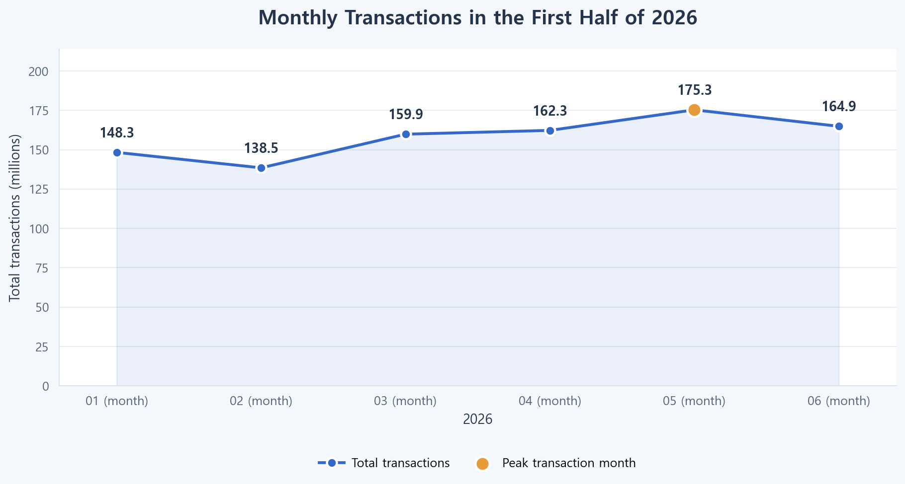
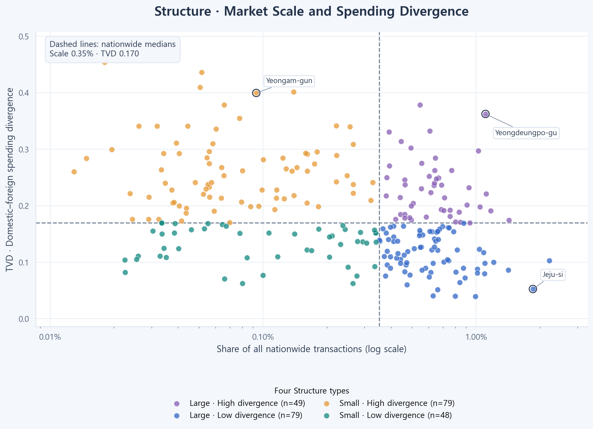
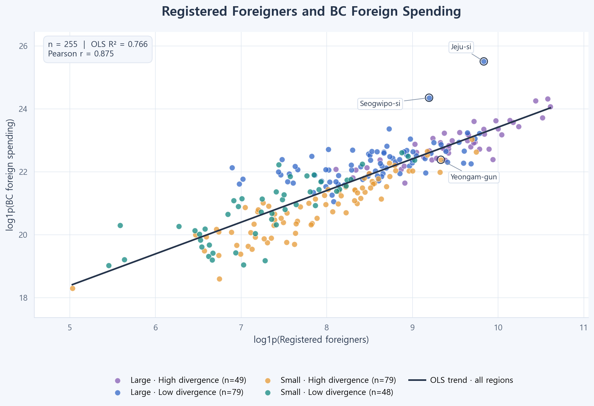
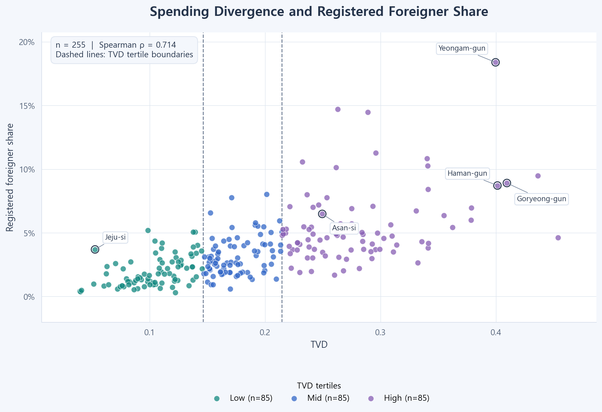
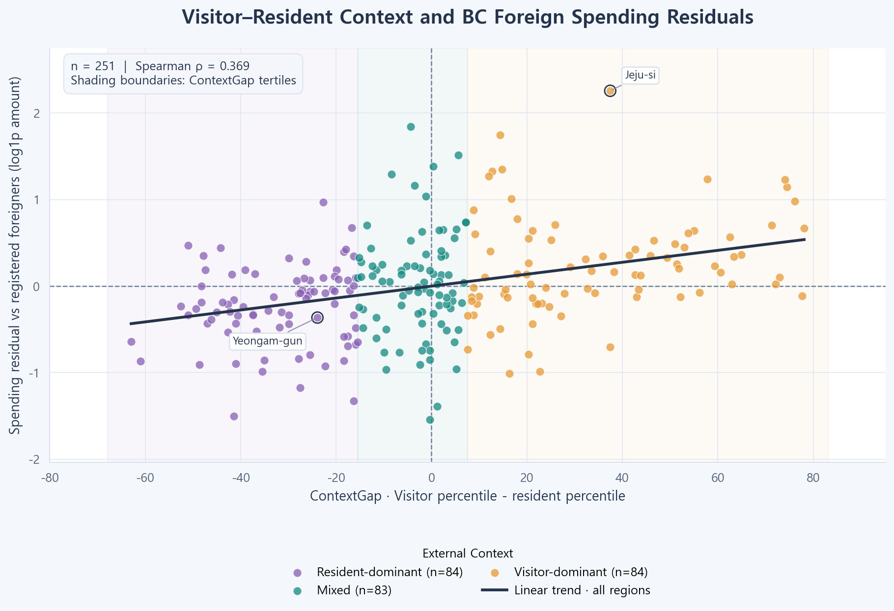

# BC Card Commercial Area Diagnosis Based on Foreign Consumer Spending Structure

This project was submitted to the 1st AI Finance Big Data Platform Consumer Data Utilization Idea Competition in South Korea.

An analysis and multilingual Action dashboard connecting spending structure, transaction changes, and resident/visitor context across 255 regions.

[English](README.md) | [한국어](README.ko.md) | [简体中文](README.zh-CN.md)

[Open the deployed dashboard](https://bccarddataanalysis.vercel.app/) — Explore the project directly in your browser without installing anything.

## Project Overview

- Problem: Ranking regions solely by foreign spending amount or share can group commercial areas with different spending structures and demand contexts into the same type. Market scale, spending structure, recent changes, and external context therefore need to be diagnosed separately.
- Approach: Using aggregated BC Card data for January–June 2026, we defined TVD as the difference between domestic and foreign consumers' industry-level spending compositions, then combined it with each region's share of nationwide transactions to classify commercial areas into 4 types. We defined Momentum as the recent change in transaction count (CNT) and average payment amount per transaction (ATV), minus the nationwide change over the same period, to examine each region's relative trajectory. Confidence assesses whether the direction and magnitude of these changes remain stable when comparison windows are changed between 3 months and 2 months. Registered foreigner, resident population, and visitor data distinguish the relative dominance of resident and visitor demand; the resulting diagnosis is linked to predefined action rules and evidence. As an optional feature, the external language model Qwen is called through an API to generate action-plan explanations based on the diagnosis and evidence.
- Usage: The dashboard supports searching, filtering, and comparing 255 regions, along with exploring industry composition, transaction changes, resident/visitor context, and supplementary supply indicators. Users can review rule-based Action Cards and evidence for card issuers, small business owners, and local governments. After server configuration, they can also use the explanation-generation feature that calls the Qwen API.

This is the analysis and web prototype for a team competition project. [BC_analysis.ipynb](BC_analysis.ipynb) is the reference for the quantitative analysis; additional web implementation rules and supplementary materials are distinguished in the [implementation notes](demo/IMPLEMENTATION.md).

## Key Results and Representative Figures

| Result | Value and interpretation |
|---|---|
| Analysis scope | 242,574 aggregate rows · 255 regions · 11 industries · January–June 2026 |
| Stability of the 4 types across periods | January–March vs April–June agreement: 92.2%, Cohen’s κ=0.893 |
| Momentum correlation across windows | 3-month vs 2-month: CNT Pearson r=0.983, ATV r=0.980 |
| External comparison of TVD | Spearman ρ=0.714 with registered foreigner share, n=255 |
| External Context | 251 regions with complete observations over 181 days; classification deferred for 4 regions |
| Rule-output validation | 3 languages × 255 regions × 3 stakeholders = 2,295 output checks |

The statistical values are stored notebook outputs and were not re-estimated from private raw data during this documentation work. Rule-output validation was rerun on the current code; these results do not measure the actual effectiveness of recommendations or the quality of LLM responses.

### 1. Monthly Transaction Changes



Monthly changes in all transactions, including corporations. The raw data is an aggregate panel rather than individual payment records.

### 2. Four Types Based on Scale × TVD



Nationwide transaction share and domestic–foreign spending structure differences are treated separately. Even among key foreign spending regions, Jeju-si and Yeongam-gun differ in structure.

### 3. External Comparison of Foreign Spending Scale



The log1p relationship between registered foreigner counts and foreign card spending: Pearson r=0.875, OLS R²=0.766, n=255. This is not interpreted as causality or predictive performance.

### 4. TVD and Registered Foreigner Share



Spearman ρ=0.714. Median registered foreigner share rises across TVD tertiles: 1.58% → 2.83% → 4.81%.

### 5. Visitor–Resident Context and Spending Residuals



Spearman ρ=0.369, n=251, between ContextGap and the residuals of log1p spending unexplained by registered foreigner scale. Visit purpose and causality are not identified.

These 5 figures were re-rendered with updated styling while retaining the existing analysis values. This README uses the English-language figures.

## Individual Contributions

My responsibilities in the team project were as follows.

- Problem definition
- Data preprocessing
- External data collection and integration
- Data visualization and analysis
- Multilingual support for the MVP website: Korean, English, and Simplified Chinese

## Data and Preprocessing

| Data | Scope and role |
|---|---|
| BC Card competition data | January–June 2026, 242,574 rows·9 columns. Aggregated by month × city/county/district × gender/foreigner × age × industry |
| Ministry of Justice registered foreigners and Ministry of the Interior and Safety resident population | Regional indicators for June 2026 joined across 255 regions |
| Korea Tourism Organization visitor data | 2026-01-01~2026-06-30, 145,152 rows according to the notebook; strict Context sample n=251 |
| Small Enterprise and Market Service commercial establishment data | Supplementary supply data reaggregated from 2,772,484 original establishments as of 2026-06-30; 37 detailed categories mapped to 8 analysis groups |
| Supplementary snapshots | Reference materials on tourism, nationality, clusters, and policy, plus synthetic closure rates. Kept separate from the core analysis and measured indicators |

Whitespace in region and industry names is normalized, and `SIDO_NM + CCG_NM` forms the regional key. `GENDER_CD=1,2` represents domestic individuals, `3` foreigners, and `x` corporations. Corporations are excluded from TVD and included in Scale·Momentum. The notebook's basic quality checks found 0 missing cells.

The denominator of foreign visit share is `out-of-town domestic visitors + foreigners`, excluding local residents. Registered foreigner share is `registered foreigners / (resident population + registered foreigners)`. Dongtan, Manse, Byeongjeom, and Hyohaeng districts in Hwaseong-si have only 150 observed days, so Context classification and Context-based recommendations are deferred.

## Methodology and Design Rationale

| Layer | Definition and role |
|---|---|
| Structure | Scale=regional share of total nationwide CNT. TVD=difference in domestic and foreign AMT compositions across 11 industries. Classified into 4 types using the median of each measure |
| Momentum | `100 × [ln(regional later/earlier) − ln(nationwide later/earlier)]` applied separately to CNT·ATV. Unit: log %p |
| Confidence | For each axis, check 3M·2M sign agreement and `min(abs(M3), abs(M2)) > 1.4826 × MAD(M3−M2)`. Both axes Stable=High, one=Medium, neither=Low |
| External Context | `Visit-share percentile − registered-foreigner-share percentile`. Average ranks and tertiles within the 251 completely observed regions classify resident-dominant, mixed, and visitor-dominant contexts |
| Action | 36 base cells from 4 Structure × 3 Context × 3 stakeholders, using rule traces and Evidence IDs. Regions with deferred Context classification are handled separately for observation |
| Explanation Generation via the Qwen API | The server constructs a diagnosis and evidence for the regional ID and language, then calls the Qwen language model through an API to generate stakeholder-specific action-plan explanations. Numerical calculations and type classification are performed by the analysis logic; the model is restricted to explaining the supplied candidate actions and evidence. |

$$TVD_r=\frac{1}{2}\sum_{k=1}^{11}|p_{D,rk}-p_{F,rk}|$$

The median thresholds are Scale=0.003508129 and TVD=0.169768457. Scale and composition differences are separated, and short-term changes are handled through separate indicators. 3M compares January–March with April–June, while 2M compares January–February with May–June; H1/H2 in the notebook refers to these earlier/later periods.

Python/pandas·NumPy perform aggregation, while SciPy·statsmodels·scikit-learn support statistical and agreement analyses. The web implementation uses HTML/CSS/JavaScript, SVG charts, a shared rule engine, and dictionaries for three languages. Qwen API calls are handled by Node.js and Vercel server functions, which pass diagnoses and evidence to the model and display the generated action-plan explanations. This project is not presented as implementing embedding search, model training, or fine-tuning.

## Evaluation Methods and Results

- Structure stability: Earlier/later regional types were compared across 255 regions. Spearman ρ=0.909 was also confirmed between transaction-count-based and amount-based TVD.
- External comparison: The notebook includes Pearson·Spearman, 5,000 bootstrap iterations, and Mann–Whitney and Kruskal–Wallis tests. The Spearman 95% bootstrap CI for TVD–registered foreigner share is [0.644, 0.772].
- Context comparison: Median TVD across resident-dominant, mixed, and visitor-dominant contexts is 0.215 → 0.164 → 0.144. ContextGap–spending residual Pearson r=0.363, while visit share alone has r=0.011.
- Aggregate cross-check: [verification.json](demo/verification.json) records agreement with reference CSVs on core labels and differences at floating-point precision. It was not regenerated during this work because private inputs were unavailable.
- Implementation checks: `npm test` was rerun and passed checks for consistent IDs, evidence, strength, and timing across languages; 2,295 rule outputs; invalid citations, numbers, and formats; non-exposure of server keys; and mock API responses. Actual paid API calls: 0.

[Rule validation record](demo/engine-verification.json) · [Supply validation summary](demo/supply_integration_verification.json) · [Test code](demo/tests/)

Confidence is a rule-based indicator of time-window stability, not a statistical confidence probability. Automated citation checks verify evidence ID usage and do not guarantee the factual accuracy or currency of external materials.

## Installation and Execution

### Use the Deployed Site

Visit [https://bccarddataanalysis.vercel.app/](https://bccarddataanalysis.vercel.app/) to explore the dashboard without installation or local execution. Korean, English, and Chinese can be selected at the top of the site. The local setup instructions below are optional and intended for development and reproduction.

### Run the Dashboard

Node.js 22.x is the reference environment, and no additional npm packages are required. Rule-based features run on the stored aggregate data.

```bash
git clone https://github.com/Heisenberg0607/bc_card_data_analysis.git
cd bc_card_data_analysis/demo
npm start
```


Open [http://localhost:3000](http://localhost:3000). Use `?lang=ko`, `?lang=en`, or `?lang=zh-CN` to select the initial language.

### Configure Qwen API-Based Explanation Generation (Optional)

Copy `demo/.env.example` to `demo/.env.local`, set `DASHSCOPE_API_KEY`, `DASHSCOPE_BASE_URL`, and `QWEN_MODEL`, then restart the server. Verify the Qwen model and API address in your own DashScope environment. Availability is not guaranteed solely by the default model name in the configuration file. Keys are read from server environment variables and are not committed.

A Python static server supports only the rule-based interface; the explanation-generation feature that calls the Qwen API will not work. For Vercel, set Root Directory=`demo`, Framework=`Other`, Output Directory=`.`, and Node.js=`22.x`. See the [demo README](demo/README.md) for details.

### Reproduce the Analysis and Regenerate Aggregates

```bash
python -m pip install numpy pandas matplotlib scipy scikit-learn statsmodels jupyter
python demo/build_final_data.py --data-root "<PRIVATE_02_DATA_PATH>"
```


The private `02_data` raw data, external data, and derived CSVs for comparison are required. Follow the [implementation notes](demo/IMPLEMENTATION.md) for exact input paths and the supply reaggregation sequence. Update the notebook's `BASE` and paths for your environment before running it. The package list above follows the code's imports; a version-pinned environment is not provided. The public repository alone cannot reproduce the full analysis from raw data.

### Implementation Checks

```bash
cd demo
npm test
```


## Main Directory Structure

| Path | Contents |
|---|---|
| `BC_analysis.ipynb` | Final analysis definitions, statistical results, and figures |
| `demo/index.html`, `app.js`, `charts.js`, `style.css` | Dashboard and SVG visualizations |
| `demo/data.js`, `build_final_data.py` | Aggregate assets and private-input validation/generation |
| `demo/kb.js`, `engine.js`, `action_templates.js` | Evidence, 36 base cells, rules, and template outputs |
| `demo/*locales.js`, `i18n.js` | Korean, English, and Chinese presentation layers |
| `demo/server/`, `api/qwen.mjs` | Local server and explanation generation through Qwen API calls |
| `demo/build_supply.py`, `supply_mapping.json` | Establishment reaggregation and industry mapping for analysis |
| `demo/tests/`, `*verification.json` | Implementation checks and aggregate validation records |
| `bc_data.py`, `foreign_clusters.py` | Separate data utilities and clustering code; the notebook is the reference for final indicators |
| `docs/images/` | Korean and English images of the 5 notebook charts used in the README |

Filenames abbreviated under `demo/` also refer to files within that directory.

## Limitations and Improvements

- The analysis is limited to BC Card, 11 industries, and 6 months of aggregates; it does not guarantee representation of the entire market, individual behavior, or causal effects. Medians and tertiles are relative classifications within the sample.
- Visitor data does not identify purpose. Visitor-dominant regions are not assumed to be tourism-oriented, and classification is deferred for 4 regions with insufficient observations.
- Supplementary closure rates are synthetic, and nationality figures are nationwide reference distributions rather than regional measurements. Tourism expenditure units assume KRW 1,000. Policy evidence includes fictional demo items and historical snapshots; source documents must be checked before treating them as current support programs.
- The 8 supply groups are an analytical mapping and are distinct from the core 11 TVD industries. Spending share minus establishment-count share does not directly measure unmet demand or business returns.
- The explanation-generation feature that calls the Qwen API was validated only with mock responses. Actual model authentication, availability, response quality, cost, latency, and the business impact of recommendations have not been validated. The current public API route lacks user authentication and persistent call limits, so deployment-owner cost controls are also needed.
- Next steps: Validation over longer and external periods, human evaluation of actual LLM responses, replacement of synthetic indicators, evidence updates, pilot-effect validation, and authentication/call limits.

## Repository, References, and Usage Terms

- [Portfolio repository](https://github.com/Heisenberg0607/bc_card_data_analysis)
- [Final analysis notebook](BC_analysis.ipynb) · [Execution guide](demo/README.md) · [Implementation and data definitions](demo/IMPLEMENTATION.md)
- [Official commercial establishment data source](https://www.data.go.kr/data/15083033/fileData.do) · [Source and hash record](demo/supply-source.json)
