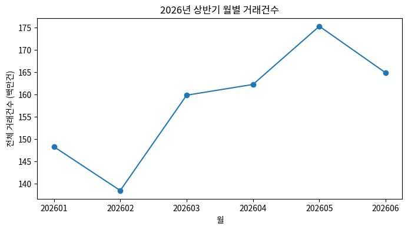
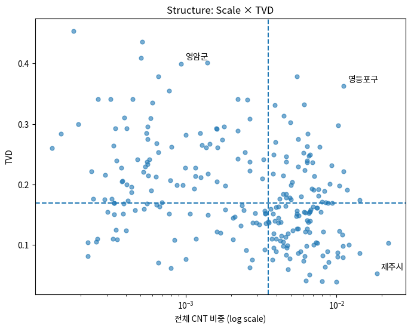
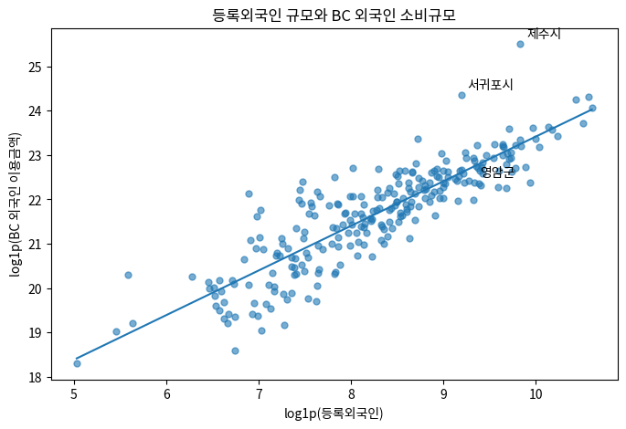
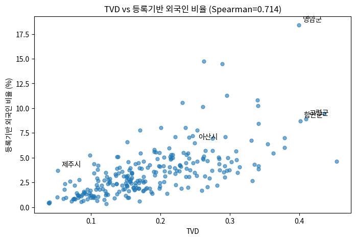
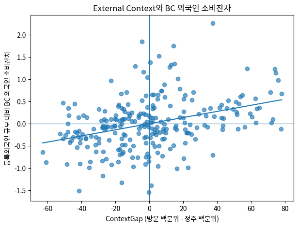

# BC卡：基于外国消费者消费结构的商圈诊断

连接255个地区的消费结构、交易变化与居住/到访背景的分析及多语言Action仪表板。

[English](README.md) | [한국어](README.ko.md) | [简体中文](README.zh-CN.md)

[查看在线仪表板](https://bccarddataanalysis.vercel.app/) — 无需本地安装，即可在浏览器中查看项目。

## 项目概览

- 问题定义：仅按外国消费者消费额或占比对地区排名，可能把消费结构和需求背景不同的商圈归为一类。因此需要分别诊断商圈规模、消费构成、近期变化和外部背景。
- 解决方法：基于2026年1—6月BC卡汇总数据，构建TVD结构四分类、相对全国的CNT/ATV Momentum和基于时间窗口稳定性的Confidence。结合登记外国人、居民登记人口和访客数据，将诊断连接到规则与证据层，并可选用Qwen解释行动建议。
- 成果用途：在仪表板中搜索、筛选和比较255个地区，查看行业构成、交易变化、居住/到访背景及补充供给指标。查看面向卡公司、商户和地方政府的规则型Action Card及证据，完成服务器配置后可请求Qwen生成解释。

这是团队竞赛项目的分析与网页原型。[BC_analysis.ipynb](BC_analysis.ipynb)定义定量分析标准；[实现说明](demo/IMPLEMENTATION.md)区分网页新增规则和补充资料。

## 主要结果与图表

| 结果 | 数值与解释 |
|---|---|
| 分析范围 | 242,574条汇总记录 · 255个地区 · 11个行业 · 2026年1—6月 |
| 结构分类的时间稳定性 | 1—3月与4—6月一致率92.2%，Cohen’s κ=0.893 |
| Momentum跨窗口相关性 | 三个月与两个月窗口：CNT Pearson r=0.983，ATV r=0.980 |
| TVD外部比较 | 与登记外国人占比的Spearman ρ=0.714，n=255 |
| External Context | 251个地区具备181天完整观测；4个地区暂缓分类 |
| 规则输出验证 | 3种语言 × 255个地区 × 3类利益相关方 = 2,295条输出检查 |

统计数值来自Notebook保存的输出，本次文档编写未使用非公开原始数据重新估计。规则输出检查已在当前代码上重新执行，不代表建议的实际效果或LLM回答质量。

### 1. 月度交易变化



包含法人交易的月度总交易笔数。输入是汇总面板，而非逐笔支付记录。

### 2. Scale × TVD四种类型



区分全国交易笔数占比与本国/外国消费者消费结构差异。同为外国消费重要地区的济州市和灵岩郡，其结构也不同。

### 3. 消费规模的外部比较



登记外国人数与外国消费者刷卡金额的log1p关系：Pearson r=0.875，OLS R²=0.766，n=255。不应解释为因果估计或预测性能。

### 4. TVD与登记外国人占比



Spearman ρ=0.714。TVD三分位组的登记外国人占比中位数依次为1.58% → 2.83% → 4.81%。

### 5. 居住/到访背景与消费残差



ContextGap与登记外国人数无法解释的log1p消费额残差之间，Spearman ρ=0.369，n=251。不识别到访目的或因果关系。

五张图均提取自原Notebook保存的输出；图内韩文标签保留原样。

## 个人贡献

在本团队项目中，我负责的工作如下：

- 问题定义
- 数据预处理
- 外部数据收集与整合
- 数据可视化与分析
- 为MVP网页添加多语言功能：支持韩文、英文和简体中文

## 数据与预处理

| 数据 | 范围与作用 |
|---|---|
| BC卡竞赛数据 | 2026年1—6月，242,574行、9列；月 × 市郡区 × 性别/外国人类别 × 年龄 × 行业汇总 |
| 韩国法务部登记外国人与行政安全部居民登记人口 | 将2026年6月地区指标连接到255个地区 |
| 韩国观光公社访客数据 | 2026-01-01—2026-06-30，Notebook记录145,152行；Context严格样本n=251 |
| 小商工人市场振兴公团商铺信息 | 重新汇总2026-06-30的2,772,484家店铺作为补充供给数据；37个细分类映射到8个分析组 |
| 补充快照 | 旅游、国籍、聚类、政策参考资料及合成停业率，与核心分析及实测指标分开 |

清理地区名和行业名中的空格，以`SIDO_NM + CCG_NM`构建地区键。`GENDER_CD=1,2`视为本国个人，`3`为外国人，`x`为法人。TVD排除法人，Scale和Momentum包含法人。Notebook初步质量检查记录缺失单元格为0。

外国访客占比的分母为`外地访客 + 外国访客`，不含本地居民。登记外国人占比为`登记外国人 / (居民登记人口 + 登记外国人)`。华城市东滩、万岁、饼店、孝行四区仅有150天观测，暂缓Context分类及相关建议。

## 方法与设计理由

| 层次 | 定义与作用 |
|---|---|
| Structure | Scale为地区全部CNT占全国总CNT的比例；TVD比较11个行业的本国/外国消费者AMT构成。分别按中位数划分为四类 |
| Momentum | 分别对CNT和ATV计算`100 × [ln(地区后期/前期) − ln(全国后期/前期)]`，单位为log百分点 |
| Confidence | 逐轴检查3M/2M符号一致且`min(abs(M3), abs(M2)) > 1.4826 × MAD(M3−M2)`。两轴Stable为High，一轴为Medium，均不满足为Low |
| External Context | 外国访客占比百分位减登记外国人占比百分位，在251个完整地区内以平均秩及三分位分为居住主导、混合、到访主导 |
| Action | 4种Structure × 3种Context × 3类利益相关方形成36个基础单元，使用规则轨迹和Evidence ID。Context暂缓地区采用单独的观察处理 |
| Qwen解释层 | 服务器依据地区ID与语言重新构建诊断和证据；指令限制LLM解释给定候选建议和证据，不负责计算或地区分类 |

$$TVD_r=\frac{1}{2}\sum_{k=1}^{11}|p_{D,rk}-p_{F,rk}|$$

中位数阈值为Scale=0.003508129、TVD=0.169768457。分别刻画市场规模与消费构成，短期变化由独立指标处理。3M比较1—3月与4—6月，2M比较1—2月与5—6月；Notebook中的H1/H2表示上述前后两个区间。

以Python/pandas和NumPy进行汇总，SciPy、statsmodels和scikit-learn支持统计与一致性分析。网页原型使用HTML/CSS/JavaScript、SVG图表、共享规则引擎和三种语言词典。Qwen通过Node.js与Vercel服务器函数连接。本项目未实现嵌入检索、模型训练或微调。

## 评估方法与结果

- 结构稳定性：比较255个地区前后期的类型；金额TVD与笔数TVD的Spearman ρ=0.909。
- 外部比较：Notebook包含Pearson/Spearman、5,000次bootstrap、Mann–Whitney及Kruskal–Wallis检验。TVD与登记外国人占比的Spearman 95% bootstrap CI为[0.644, 0.772]。
- Context比较：居住主导、混合、到访主导三组的TVD中位数依次为0.215 → 0.164 → 0.144。ContextGap与消费残差的Pearson r=0.363，而单独访客占比的r=0.011。
- 汇总核对：[verification.json](demo/verification.json)记录与基准CSV核心标签一致，数值差异处于浮点精度量级。因缺少非公开输入，本次未重新生成该记录。
- 实现检查：重新执行`npm test`，通过跨语言ID/证据/强度/时点一致性、2,295条规则输出、错误引用/数值/格式、服务器密钥不暴露和模拟API响应检查。实际付费API调用为0次。

[规则验证记录](demo/engine-verification.json) · [供给验证摘要](demo/supply_integration_verification.json) · [测试代码](demo/tests/)

Confidence是时间窗口稳定性规则指标，并非统计置信概率。自动引用检查验证Evidence ID的使用，不保证外部证据真实或仍然有效。

## 安装与运行

### 使用已部署的网站

访问[https://bccarddataanalysis.vercel.app/](https://bccarddataanalysis.vercel.app/)，无需安装或启动本地服务器即可查看仪表板。可在网站顶部选择韩文、英文或简体中文。以下本地运行说明为可选内容，用于开发和复现。

### 运行仪表板

以Node.js 22.x为目标环境，无需额外npm依赖。规则功能可使用已保存的汇总数据运行。

```bash
git clone https://github.com/Heisenberg0607/bc_card_data_analysis.git
cd bc_card_data_analysis/demo
npm start
```


访问[http://localhost:3000](http://localhost:3000)。通过`?lang=ko`、`?lang=en`或`?lang=zh-CN`选择初始语言。

### 可选Qwen配置

将`demo/.env.example`复制为`demo/.env.local`，设置`DASHSCOPE_API_KEY`、`DASHSCOPE_BASE_URL`和`QWEN_MODEL`后重启服务器。实际模型和地址的可用性需在自己的DashScope环境中确认，配置中的默认模型名称不保证可用。密钥从服务器环境变量读取，不得提交到仓库。

Python静态服务器支持规则界面，但不支持Qwen服务器接口。Vercel配置为Root Directory=`demo`、Framework=`Other`、Output Directory=`.`、Node.js=`22.x`。详见[demo README](demo/README.md)。

### 复现分析与重新生成汇总

```bash
python -m pip install numpy pandas matplotlib scipy scikit-learn statsmodels jupyter
python demo/build_final_data.py --data-root "<PRIVATE_02_DATA_PATH>"
```


需要非公开`02_data`中的原始输入、外部数据和用于比较的derived CSV。准确输入路径及供给重建顺序见[实现说明](demo/IMPLEMENTATION.md)。运行Notebook前按环境调整`BASE`和路径。以上包列表依据代码import整理，未提供固定版本环境。仅凭公开仓库无法从原始数据完整复现全部分析。

### 实现检查

```bash
cd demo
npm test
```


## 主要目录结构

| 路径 | 内容 |
|---|---|
| `BC_analysis.ipynb` | 最终分析定义、统计结果与图表 |
| `demo/index.html`, `app.js`, `charts.js`, `style.css` | 仪表板与SVG可视化 |
| `demo/data.js`, `build_final_data.py` | 汇总资产及非公开输入验证与构建 |
| `demo/kb.js`, `engine.js`, `action_templates.js` | 证据、36个基础单元、规则和模板输出 |
| `demo/*locales.js`, `i18n.js` | 韩文、英文、简体中文显示层 |
| `demo/server/`, `api/qwen.mjs` | 本地服务器与Qwen服务器连接 |
| `demo/build_supply.py`, `supply_mapping.json` | 店铺汇总和分析用行业映射 |
| `demo/tests/`, `*verification.json` | 实现测试与汇总验证记录 |
| `bc_data.py`, `foreign_clusters.py` | 独立数据工具与聚类代码；最终指标以Notebook为准 |
| `docs/images/` | README使用的五张Notebook图表 |

在`demo/`下合并列出的短文件名也指该目录内的文件。

## 局限与后续方向

- 仅涵盖BC卡、11个行业和六个月汇总数据，不保证全市场代表性、个体行为或因果效果。中位数和三分位均为样本内相对分类。
- 访客数据不识别目的，不能把到访主导直接等同旅游需求；四个观测不足地区暂缓分类。
- 补充停业率为合成数据，国籍分布为全国参考而非地区实测。旅游支出采用千韩元单位假设。政策证据包含演示用虚构条目及历史快照，作为当前项目使用前须核查原公告。
- 八个供给组是分析用映射，与核心TVD的11行业分开。消费金额占比减店铺数量占比并非未满足需求或经营收益的直接测量。
- Qwen仅完成模拟响应验证。实际认证、模型可用性、回答质量、成本、延迟和商业效果尚未验证。当前公开API缺少用户认证和持久化限流，部署时需进一步控制所有者成本。
- 后续方向：更长时间及样本期外验证、真实LLM回答的人工评估、替换合成指标、更新证据、试点效果验证，以及认证和调用限额。

## 项目仓库、参考资料与使用条件

- [作品集仓库](https://github.com/Heisenberg0607/bc_card_data_analysis)
- [最终分析Notebook](BC_analysis.ipynb) · [运行说明](demo/README.md) · [实现与数据定义](demo/IMPLEMENTATION.md)
- [官方商铺数据来源](https://www.data.go.kr/data/15083033/fileData.do) · [来源与哈希记录](demo/supply-source.json)

当前仓库未发现单独的LICENSE。公开可见不代表可自由使用或再分发。代码与外部资料须遵守权利人、竞赛及提供机构的适用条款，不上传非公开原始数据及API密钥。
